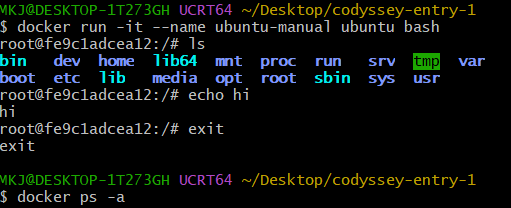
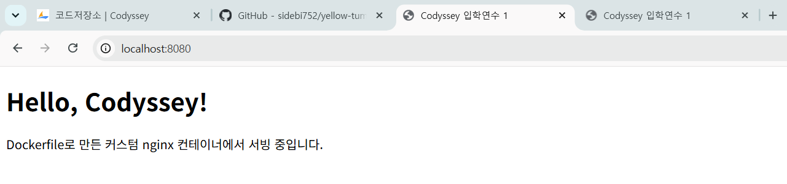
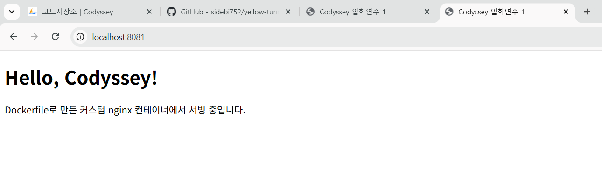
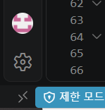
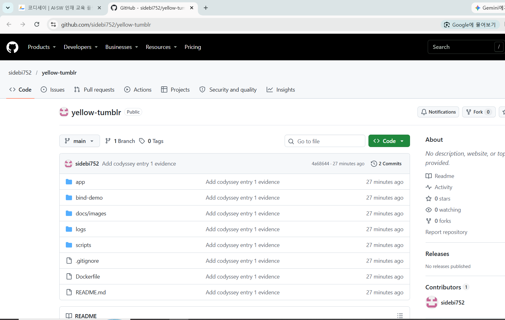

# 코디세이 입학연수 1 — 개발 워크스테이션 구축

## 0. 프로젝트 개요

이 저장소는 코디세이 입학연수 1 미션의 결과물이다. 터미널(리눅스 CLI), Docker, Git/GitHub로
"재현 가능한 개발 환경"을 직접 구성하고, 모든 수행 결과를 명령어·출력 로그로 검증했다.

## 1. 실행 환경

| 항목 | 값 |
|---|---|
| OS | MINGW64_NT-10.0-19045 DESKTOP-1T273GH 3.6.10-5a1665c8.x86_64 2026-09-28 10:40 UTC x86_64 Msys |
| Shell / 터미널 | /usr/bin/bash \| GNU bash, version 5.3.15(2)-release (x86_64-pc-cygwin) |
| Docker 버전 | Docker version 29.7.2, build a7dcaa6 |
| Git 버전 | git version 2.56.0.windows.4 |
| 에디터 | VSCode 1.134.0 버전 |

## 2. 수행 체크리스트

- [x] 터미널 기본 조작 (이동/생성/복사/이름변경/삭제) → [3-1](#3-1-터미널-조작-로그)
- [x] 권한 변경 실습 (파일 1 + 디렉토리 1) → [3-2](#3-2-권한-실습)
- [x] Docker 설치/데몬 점검 → [4-1](#4-1-docker-설치데몬-점검)
- [x] hello-world 실행 → [4-2](#4-2-hello-world)
- [x] 이미지/컨테이너 운영 명령 (images, ps, logs, stats) → [4-3](#4-3-이미지컨테이너-운영)
- [x] ubuntu 컨테이너 진입 + exec/attach 관찰 → [4-4](#4-4-ubuntu-컨테이너-실습)
- [x] Dockerfile 커스텀 이미지 빌드/실행 → [5](#5-dockerfile-기반-웹-서버-커스텀-이미지)
- [x] 포트 매핑 접속 증거 (2회) → [6](#6-포트-매핑-접속-증거)
- [x] 바인드 마운트 반영 → [7-1](#7-1-바인드-마운트)
- [x] Docker 볼륨 영속성 → [7-2](#7-2-docker-볼륨-영속성)
- [x] Git 설정 + GitHub/VSCode 연동 → [8](#8-git-설정-및-github-연동)
- [x] 개념 설명 6개 → [9](#9-개념-설명)
- [x] 트러블슈팅 2건 이상 → [10](#10-트러블슈팅)

### 2-1. 증거 한눈에 보기 (Evidence Index)

> 링크를 누르면 해당 로그/스크린샷/스크립트로 바로 이동합니다. (저장소 안의 상대 경로 링크)

| 수행 항목 | 실행 스크립트 | 로그(명령+출력) | 스크린샷 |
|---|---|---|---|
| 실행 환경 | [00-env.sh](scripts/00-env.sh) | [00-env.log](logs/00-env.log) | - |
| 터미널 조작 | [01-terminal.sh](scripts/01-terminal.sh) | [01-terminal.log](logs/01-terminal.log) | - |
| 권한 실습 | [02-permissions.sh](scripts/02-permissions.sh) | [02-permissions.log](logs/02-permissions.log) | - |
| Docker 점검/hello-world | [03-docker-check.sh](scripts/03-docker-check.sh) | [03-docker-check.log](logs/03-docker-check.log) | - |
| 컨테이너 운영 | [04-container-ops.sh](scripts/04-container-ops.sh) | [04-container-ops.log](logs/04-container-ops.log) | [ubuntu 진입](docs/images/04-ubuntu-interactive.png) |
| 빌드 + 포트 매핑 | [05-web-build-run.sh](scripts/05-web-build-run.sh) | [05-web-build-run.log](logs/05-web-build-run.log) | [8080](docs/images/06-browser-8080.png) · [8081](docs/images/06-browser-8081.png) |
| 볼륨 / 바인드 마운트 | [06-volume-bindmount.sh](scripts/06-volume-bindmount.sh) | [06-volume-bindmount.log](logs/06-volume-bindmount.log) | - |
| Git / GitHub 연동 | [07-git-check.sh](scripts/07-git-check.sh) | [07-git-check.log](logs/07-git-check.log) · [첫 push](logs/07-first-push.log) | [VSCode](docs/images/08-vscode-github.png) · [커밋 목록](docs/images/08-github-commits.png) |

저장소 주소: <https://github.com/sidebi752/yellow-tumblr>

## 3. 터미널 / 권한

### 3-1. 터미널 조작 로그

> 확인한 것: pwd, ls -la(숨김 포함), mkdir, cd, touch, cat, cp, mv(이동/이름변경), rm/rmdir

<details>
<summary>📄 터미널 조작 로그 펼쳐 보기 (클릭)</summary>

01-terminal  (2026-11-03 22:26:04)
#### 0. 실습 폴더 초기화 (매번 같은 결과가 나오도록)
```bash
$ rm -rf "/c/Users/***/codyssey-practice"
```
#### 1. 현재 위치 확인 / 목록 확인(숨김 파일 포함)
```bash
$ pwd
/c/Users/***/Desktop/codyssey-entry-1/scripts

$ ls -la
total 39
drwxr-xr-x 1 *** 197121    0 Nov  1 22:34 ./
drwxr-xr-x 1 *** 197121    0 Nov  3 22:12 ../
-rwxr-xr-x 1 *** 197121  295 Nov  1 22:34 00-env.sh*
-rwxr-xr-x 1 *** 197121 1331 Nov  1 22:34 01-terminal.sh*
-rwxr-xr-x 1 *** 197121 1012 Nov  1 22:34 02-permissions.sh*
-rwxr-xr-x 1 *** 197121  564 Nov  1 22:34 03-docker-check.sh*
-rwxr-xr-x 1 *** 197121 1233 Nov  1 22:34 04-container-ops.sh*
-rwxr-xr-x 1 *** 197121 1931 Nov  1 22:34 05-web-build-run.sh*
-rwxr-xr-x 1 *** 197121 2042 Nov  1 22:34 06-volume-bindmount.sh*
-rwxr-xr-x 1 *** 197121  671 Nov  1 22:34 07-git-check.sh*
-rwxr-xr-x 1 *** 197121  363 Nov  1 22:34 99-cleanup.sh*
-rwxr-xr-x 1 *** 197121 1022 Nov  1 22:34 lib.sh*
```
#### 2. 디렉토리 생성 + 이동
```bash
$ mkdir -p "/c/Users/***/codyssey-practice/dir-a" "/c/Users/***/codyssey-practice/dir-b"

$ cd "/c/Users/***/codyssey-practice"

$ pwd
/c/Users/***/codyssey-practice
```
#### 3. 빈 파일 생성 / 내용이 있는 파일 생성 / 내용 확인
```bash
$ touch empty.txt

$ echo 'hello codyssey' > hello.txt

$ cat hello.txt
hello codyssey

$ ls -la
total 25
drwxr-xr-x 1 *** 197121  0 Nov  3 22:26 ./
drwxr-xr-x 1 *** 197121  0 Nov  3 22:26 ../
drwxr-xr-x 1 *** 197121  0 Nov  3 22:26 dir-a/
drwxr-xr-x 1 *** 197121  0 Nov  3 22:26 dir-b/
-rw-r--r-- 1 *** 197121  0 Nov  3 22:26 empty.txt
-rw-r--r-- 1 *** 197121 15 Nov  3 22:26 hello.txt
```
#### 4. 복사 / 이동 / 이름 변경
```bash
$ cp hello.txt dir-a/hello-copy.txt

$ mv hello.txt renamed.txt

$ mv renamed.txt dir-b/

$ ls -R
.:
dir-a/
dir-b/
empty.txt

./dir-a:
hello-copy.txt

./dir-b:
renamed.txt
```
#### 5. 절대 경로 vs 상대 경로 (같은 파일을 두 방식으로 읽기)
```bash
$ cat "/c/Users/***/codyssey-practice/dir-b/renamed.txt"
hello codyssey

$ cd dir-b && pwd
/c/Users/***/codyssey-practice/dir-b

$ cat ./renamed.txt
hello codyssey

$ cat ../dir-a/hello-copy.txt
hello codyssey

$ cd "/c/Users/***/codyssey-practice"
```
#### 6. 삭제
```bash
$ rm dir-a/hello-copy.txt

$ rmdir dir-a

$ rm -r dir-b

$ ls -la
total 24
drwxr-xr-x 1 *** 197121 0 Nov  3 22:26 ./
drwxr-xr-x 1 *** 197121 0 Nov  3 22:26 ../
-rw-r--r-- 1 *** 197121 0 Nov  3 22:26 empty.txt
```
</details>

### 3-2. 권한 실습
작업 환경: ubuntu 컨테이너 안에서 실행

#### 0. 작업 폴더 준비
```bash
$ mkdir -p /tmp/perm/secret-dir

$ cd /tmp/perm

$ printf '#!/usr/bin/env bash
echo script is running
' > hello.sh
```
#### 1. 파일 권한: 변경 전, 기본 644 = rw-r--r--
```bash
$ ls -l hello.sh
-rw-r--r-- 1 root root 43 Nov  3 14:18 hello.sh
```
#### 2. 실행 권한(x)이 없으면 실행이 막힌다
```bash
$ ./hello.sh
bash: line 1: ./hello.sh: Permission denied
```
#### 3. chmod 755 로 변경 → 실행 가능
```bash
$ chmod 755 hello.sh

$ ls -l hello.sh
-rwxr-xr-x 1 root root 43 Nov  3 14:18 hello.sh

$ ./hello.sh
script is running
```
#### 4. 기호 방식으로도 변경해 보기 (u=소유자, g=그룹, o=그 외)
```bash
$ chmod go-rx hello.sh

$ ls -l hello.sh
-rwx------ 1 root root 43 Nov  3 14:18 hello.sh

$ chmod 644 hello.sh

$ ls -l hello.sh
-rw-r--r-- 1 root root 43 Nov  3 14:18 hello.sh
```
#### 5. 디렉토리 권한: 변경 전 / 후
```bash
$ ls -ld secret-dir
drwxr-xr-x 2 root root 4096 Nov  3 14:18 secret-dir

$ chmod 700 secret-dir

$ ls -ld secret-dir
drwx------ 2 root root 4096 Nov  3 14:18 secret-dir

$ chmod 755 secret-dir

$ ls -ld secret-dir
drwxr-xr-x 2 root root 4096 Nov  3 14:18 secret-dir

# 권한을 바꾼 이유: 'hello.sh'에 실행 권한(x)이 없어 실행이 막힘. 따라서 755로 부여
# 관찰한 점: 644일 때 ./hello.sh 가 "Permission denied" 였고 755 후 실행된 것 "script is running"
```

 

## 4. Docker 점검 / 운영

### 4-1. Docker 설치/데몬 점검
```bash
$ docker --version
 Version:           29.7.2. build a7dcaa6

$ docker version
 Server: Docker Desktop 4.88.0 (237115)
 Engine:
  Version:          29.7.2
  API version:      1.55 (minimum version 1.40)
  Go version:       go1.26.5
  Git commit:       6a43e3d
  Built:            Wed Aug  5 18:28:36 2026
  OS/Arch:          linux/amd64
  Experimental:     false
 containerd:
  Version:          v2.3.3
  GitCommit:        aad11006b869517fcd3009450b6f82da282e1a9b
 runc:
  Version:          1.4.3
  GitCommit:        v1.4.3-0-gbb14dabe
 docker-init:
  Version:          0.19.0
  GitCommit:        de40ad0

$ docker info   
Client:
 Version:    29.7.2
 Context:    desktop-linux
 Debug Mode: false
 Plugins:
  agent: Docker AI Agent Runner (Docker Inc.)
    Version:  v1.124.0
    Path:     C:\Users\***\.docker\cli-plugins\docker-agent.exe
  ai: Docker AI Agent - Ask Gordon (Docker Inc.)
    Version:  v1.30.0
    Path:     C:\Users\***\.docker\cli-plugins\docker-ai.exe
  buildx: Docker Buildx (Docker Inc.)
    Version:  v0.36.1-desktop.1
    Path:     C:\Users\***\.docker\cli-plugins\docker-buildx.exe
  compose: Docker Compose (Docker Inc.)
    Version:  v5.4.0
    Path:     C:\Users\***\.docker\cli-plugins\docker-compose.exe
  debug: Get a shell into any image or container (Docker Inc.)
    Version:  0.0.47
    Path:     C:\Users\***\.docker\cli-plugins\docker-debug.exe
  desktop: Docker Desktop commands (Docker Inc.)
    Version:  v0.4.3
    Path:     C:\Users\***\.docker\cli-plugins\docker-desktop.exe
  dhi: CLI for managing Docker Hardened Images (Docker Inc.)
    Version:  v0.0.7
    Path:     C:\Users\***\.docker\cli-plugins\docker-dhi.exe
  extension: Manages Docker extensions (Docker Inc.)
    Version:  v0.2.31
    Path:     C:\Users\***\.docker\cli-plugins\docker-extension.exe
  init: Creates Docker-related starter files for your project (Docker Inc.)
    Version:  v1.4.0
    Path:     C:\Users\***\.docker\cli-plugins\docker-init.exe
  mcp: Docker MCP Plugin (Docker Inc.)
    Version:  v0.43.3
    Path:     C:\Users\***\.docker\cli-plugins\docker-mcp.exe
  model: Docker Model Runner (Docker Inc.)
    Version:  v1.2.6
    Path:     C:\Users\***\.docker\cli-plugins\docker-model.exe
  offload: Docker Offload (Docker Inc.)
    Version:  v0.6.13
    Path:     C:\Users\***\.docker\cli-plugins\docker-offload.exe
  pass: Docker Pass Secrets Manager Plugin (beta) (Docker Inc.)
    Version:  v0.2.1
    Path:     C:\Users\***\.docker\cli-plugins\docker-pass.exe
  sandbox: "docker sandbox" is deprecated, use Docker Sandboxes instead (Docker Inc.)
    Version:  v0.13.0
    Path:     C:\Users\***\.docker\cli-plugins\docker-sandbox.exe
  scout: Docker Scout (Docker Inc.)
    Version:  v1.24.0
    Path:     C:\Users\***\.docker\cli-plugins\docker-scout.exe

Server:
 Containers: 4
  Running: 0
  Paused: 0
  Stopped: 4
 Images: 3
 Server Version: 29.7.2
 Storage Driver: overlayfs
  driver-type: io.containerd.snapshotter.v1
 Logging Driver: json-file
 Cgroup Driver: cgroupfs
 Cgroup Version: 2
 Plugins:
  Volume: local
  Network: bridge host ipvlan macvlan null overlay
  Log: awslogs fluentd gcplogs gelf journald json-file local splunk syslog
 CDI spec directories:
  /etc/cdi
  /var/run/cdi
 Discovered Devices:
  cdi: docker.com/gpu=webgpu
 Swarm: inactive
 Runtimes: io.containerd.runc.v2 nvidia runc
 Default Runtime: runc
 Init Binary: docker-init
 containerd version: aad11006b869517fcd3009450b6f82da282e1a9b
 runc version: v1.4.3-0-gbb14dabe
 init version: de40ad0
 Security Options:
  seccomp
   Profile: builtin
  cgroupns
 Kernel Version: 6.18.54.1-microsoft-standard-WSL2
 Operating System: Docker Desktop (containerized)
 OSType: linux
 Architecture: x86_64
 CPUs: 8
 Total Memory: 3.734GiB
 Name: docker-desktop
 ID: ef3ccb55-da57-42fd-acb6-86db21536352
 Docker Root Dir: /var/lib/docker
 Debug Mode: false
 HTTP Proxy: http.docker.internal:3128
 HTTPS Proxy: http.docker.internal:3128
 No Proxy: hubproxy.docker.internal
 Labels:
  com.docker.desktop.address=npipe://\\.\pipe\docker_cli
 Experimental: false
 Insecure Registries:
  hubproxy.docker.internal:5555
  ::1/128
  127.0.0.0/8
 Live Restore Enabled: false
 Firewall Backend: iptables

 # Server 섹션이 응답함 = 데몬 정상
```

### 4-2. hello-world
```bash
$ docker run --rm hello-world
Unable to find image 'hello-world:latest' locally
latest: Pulling from library/hello-world
4f55086f7dd0: Pulling fs layer
4f55086f7dd0: Download complete
4f55086f7dd0: Pull complete
d5e71e642bf5: Download complete
Digest: sha256:c567b231f65614688711a75f31518a064258a51d442117a3e771a3a8fdba78ef
Status: Downloaded newer image for hello-world:latest

Hello from Docker!
This message shows that your installation appears to be working correctly.

To generate this message, Docker took the following steps:
 1. The Docker client contacted the Docker daemon.
 2. The Docker daemon pulled the "hello-world" image from the Docker Hub.
    (amd64)
 3. The Docker daemon created a new container from that image which runs the
    executable that produces the output you are currently reading.
 4. The Docker daemon streamed that output to the Docker client, which sent it
    to your terminal.

To try something more ambitious, you can run an Ubuntu container with:
 $ docker run -it ubuntu bash

Share images, automate workflows, and more with a free Docker ID:
 https://hub.docker.com/

For more examples and ideas, visit:
 https://docs.docker.com/get-started/
```
### 4-3. 이미지/컨테이너 운영
```bash
$ docker images
                                                                               i Info →   U  In Use
IMAGE                             ID             DISK USAGE   CONTENT SIZE   EXTRA
andalog-api:latest                ba63f9e60377        292MB         69.1MB    U
docker/welcome-to-docker:latest   c4d56c24da4f       22.2MB         6.03MB    U
hello-world:latest                c567b231f656       25.9kB         9.49kB
my-web:1.0                        f7d098b7a68c       93.6MB         26.3MB    U
nginx:1.27-alpine                 65645c7bb6a0       74.5MB         21.9MB    U
nginx:alpine                      785835ea65db       94.5MB         27.2MB    U
ubuntu:latest                     6a06111c3b0a        163MB         45.9MB    U


$ docker ps -a
CONTAINER ID   IMAGE                             COMMAND                   CREATED         STATUS
                    PORTS                  NAMES
36d8583e672e   ubuntu                            "sh -c 'echo contain…"   6 minutes ago   Exited (13
7) 3 seconds ago                          ubuntu-keep
ac0b68456b0a   my-web:1.0                        "/docker-entrypoint.…"   14 hours ago    Exited (25
5) 4 hours ago     0.0.0.0:8090->80/tcp   my-web-8090
fe9c1adcea12   ubuntu                            "bash"                    15 hours ago    Exited (0
) 15 hours ago                             ubuntu-manual
36064efb0646   nginx:alpine                      "/docker-entrypoint.…"   16 hours ago    Exited (25
5) 4 hours ago     0.0.0.0:8082->80/tcp   bind-test
f93fc6447596   ubuntu                            "sleep infinity"          16 hours ago    Exited (2
55) 4 hours ago                            vol-test2
3ee817534ab4   my-web:1.0                        "/docker-entrypoint.…"   16 hours ago    Exited (25
5) 4 hours ago     0.0.0.0:8081->80/tcp   my-web-8081
268144b1f874   my-web:1.0                        "/docker-entrypoint.…"   16 hours ago    Exited (25
5) 4 hours ago     0.0.0.0:8080->80/tcp   my-web-8080
38545a83f7c1   nginx:1.27-alpine                 "/docker-entrypoint.…"   2 months ago    Exited (0)
 2 months ago                             andalog-nginx-1
29ae5ef9f64b   andalog-api                       "uvicorn app.main:ap…"   2 months ago    Exited (0)
 2 months ago                             andalog-api-1
34f38a14bce0   99703de8339a                      "uvicorn app.main:ap…"   2 months ago    Exited (0)
 2 months ago                             adoring_perlman
a410547e7dd6   docker/welcome-to-docker:latest   "/docker-entrypoint.…"   2 months ago    Exited (13
7) 2 months ago                           welcome-to-docker


$ docker logs ubuntu-keep
container-started

$ docker stats --no-stream
CONTAINER ID   NAME          CPU %     MEM USAGE / LIMIT     MEM %     NET I/O         BLOCK I/O
 PIDS
36d8583e672e   ubuntu-keep   0.00%     3.832MiB / 3.734GiB   0.10%     1.17kB / 126B   18.7MB / 0B
 2
```
### 4-4. ubuntu 컨테이너 실습
```bash
$ docker run -dit --name ubuntu-test ubuntu bash
61659d34522e41c3717413dc12b268f228f01d541a142e6e80e08e7d903f2ea8

***@DESKTOP-1T273GH UCRT64 ~/codyssey-entry-1 (main)
$ docker exec -it ubuntu-test bash
root@61659d34522e:/# exit
exit

What's next:
    Try Docker Debug for seamless, persistent debugging tools in any container or image → docker deb
ug ubuntu-test
    Learn more at https://docs.docker.com/go/debug-cli/

***@DESKTOP-1T273GH UCRT64 ~/codyssey-entry-1 (main)
$ docker ps
CONTAINER ID   IMAGE     COMMAND   CREATED          STATUS          PORTS     NAMES
61659d34522e   ubuntu    "bash"    32 seconds ago   Up 31 seconds             ubuntu-test

***@DESKTOP-1T273GH UCRT64 ~/codyssey-entry-1 (main)
$ docker attach ubuntu-test
root@61659d34522e:/# exit
exit

***@DESKTOP-1T273GH UCRT64 ~/codyssey-entry-1 (main)
$ docker ps -a
CONTAINER ID   IMAGE                             COMMAND                   CREATED          STATUS
                     PORTS                  NAMES
61659d34522e   ubuntu                            "bash"                    56 seconds ago   Exited (
0) 5 seconds ago                            ubuntu-test
36d8583e672e   ubuntu                            "sh -c 'echo contain…"   8 minutes ago    Exited (1
37) 2 minutes ago                          ubuntu-keep
ac0b68456b0a   my-web:1.0                        "/docker-entrypoint.…"   15 hours ago     Exited (2
55) 4 hours ago     0.0.0.0:8090->80/tcp   my-web-8090
fe9c1adcea12   ubuntu                            "bash"                    15 hours ago     Exited (
0) 15 hours ago                             ubuntu-manual
36064efb0646   nginx:alpine                      "/docker-entrypoint.…"   16 hours ago     Exited (2
55) 4 hours ago     0.0.0.0:8082->80/tcp   bind-test
f93fc6447596   ubuntu                            "sleep infinity"          16 hours ago     Exited (
255) 4 hours ago                            vol-test2
3ee817534ab4   my-web:1.0                        "/docker-entrypoint.…"   16 hours ago     Exited (2
55) 4 hours ago     0.0.0.0:8081->80/tcp   my-web-8081
268144b1f874   my-web:1.0                        "/docker-entrypoint.…"   16 hours ago     Exited (2
55) 4 hours ago     0.0.0.0:8080->80/tcp   my-web-8080
38545a83f7c1   nginx:1.27-alpine                 "/docker-entrypoint.…"   2 months ago     Exited (0
) 2 months ago                             andalog-nginx-1
29ae5ef9f64b   andalog-api                       "uvicorn app.main:ap…"   2 months ago     Exited (0
) 2 months ago                             andalog-api-1
34f38a14bce0   99703de8339a                      "uvicorn app.main:ap…"   2 months ago     Exited (0
) 2 months ago                             adoring_perlman
a410547e7dd6   docker/welcome-to-docker:latest   "/docker-entrypoint.…"   2 months ago     Exited (1
37) 2 months ago                           welcome-to-docker

***@DESKTOP-1T273GH UCRT64 ~/codyssey-entry-1 (main)
$ docker start ubuntu-test && docker attach ubuntu-test
ubuntu-test
root@61659d34522e:/# read escape sequence

***@DESKTOP-1T273GH UCRT64 ~/codyssey-entry-1 (main)
$ docker ps
CONTAINER ID   IMAGE     COMMAND   CREATED         STATUS          PORTS     NAMES
61659d34522e   ubuntu    "bash"    2 minutes ago   Up 14 seconds             ubuntu-test
```



exec vs attach 관찰 정리: 

exec: 내가 띄운 프로세스만 끝남. 컨테이너 유지
attach: ctrl p, ctrl q 안하고 나오면 컨테이너 꺼짐


## 5. Dockerfile 기반 웹 서버 커스텀 이미지

선택한 방식: (A) 웹 서버 베이스 이미지(`nginx:alpine`) + 정적 콘텐츠/설정 교체

| 커스텀 포인트 | 목적 |
|---|---|
| `LABEL` | 이미지 이름, 설명을 메타데이터로 남겨 관리, 검색을 쉽게 함 |
| `ENV APP_ENV=dev` | 컨테이너 안에서 참조할 실행 모드 값(설정과 코드의 분리 예시) |
| `COPY app/ ...` | 기본 nginx 화면을 내가 만든 페이지로 교체 |
| `HEALTHCHECK` | 컨테이너 안에서 웹 서버가 정상 응답하는지 주기적으로 점검 |

빌드/실행 로그:
```bash
$ cat Dockerfile
# 기존 베이스: nginx:alpine (공식 NGINX 웹 서버 이미지, alpine = 아주 가벼운 리눅스)
# 방식 (A): 웹 서버 베이스 이미지 + 정적 콘텐츠/설정만 교체
FROM nginx:alpine

# 커스텀 포인트 1. 메타데이터 라벨: 이미지가 무엇인지 표시 (관리/검색용)
LABEL org.opencontainers.image.title="my-custom-nginx"
LABEL org.opencontainers.image.description="Codyssey 입학연수 1 - custom nginx web server"

# 커스텀 포인트 2. 컨테이너 안에서 참조할 실행 모드 값(설정과 코드의 분리 예시)
ENV APP_ENV=dev

# 커스텀 포인트 3. 정적 콘텐츠 교체: 기본 nginx 페이지 → 내가 만든 app/index.html
COPY app/ /usr/share/nginx/html/

# 커스텀 포인트 4. 헬스체크: 컨테이너 안에서 웹 서버가 정상 응답하는지 주기적으로 확인
HEALTHCHECK --interval=5s --timeout=3s --retries=3 \
  CMD wget -q -O /dev/null http://localhost/ || exit 1

# 이 컨테이너가 80번 포트를 쓴다는 문서화 (실제 연결은 docker run -p 로 함)
EXPOSE 80

$ docker build -t my-web:1.0 .
[+] Building 1.6s (7/7) FINISHED                                               docker:desktop-linux
 => [internal] load build definition from Dockerfile                                           0.1s
 => => transferring dockerfile: 1.12kB                                                         0.0s
 => [internal] load metadata for docker.io/library/nginx:alpine                                0.1s
 => [internal] load .dockerignore                                                              0.0s
 => => transferring context: 2B                                                                0.0s
 => [internal] load build context                                                              0.1s
 => => transferring context: 415B                                                              0.0s
 => CACHED [1/2] FROM docker.io/library/nginx:alpine@sha256:785835ea65db4bba6f021acc0f3be91b0  0.1s
 => => resolve docker.io/library/nginx:alpine@sha256:785835ea65db4bba6f021acc0f3be91b0fef76a5  0.1s
 => [2/2] COPY app/ /usr/share/nginx/html/                                                     0.1s
 => exporting to image                                                                         0.8s
 => => exporting layers                                                                        0.4s
 => => exporting manifest sha256:fbfdb3068171aefb49f88da1ef7f886797105c252785fa47a3fc62b48cbe  0.1s
 => => exporting config sha256:13d2ae965bef38fe1bd8785c14c706133b59cae4f14527367d5049e288abc5  0.0s
 => => exporting attestation manifest sha256:9133765361fab7d63a6880e420180f74b73551612cf7bbac  0.1s
 => => exporting manifest list sha256:d9295ee2ee2f225c51e9cd19cbe5e4b88cf40baedfc95c642b74c21  0.1s
 => => naming to docker.io/library/my-web:1.0                                                  0.0s
 => => unpacking to docker.io/library/my-web:1.0                                               0.1s

$ docker run -d -p 8080:80 --name my-web-8080 my-web:1.0
268144b1f874e3bd34ab75a946f62d049eec56585a3cda518fe68f79ad968416

$ docker run -d -p 8081:80 --name my-web-8081 my-web:1.0
f6337075333b3cbbca1eda5577bf3a1651d1291eb900a34bd361737e353a541d
```

```bash
$ docker exec my-web-8080 printenv APP_ENV
dev
```

## 6. 포트 매핑 접속 증거

`-p <호스트포트>:<컨테이너포트>` 로 2회 실행했다. (8080→80, 8081→80)
```bash
$ curl -s http://localhost:8080
<!DOCTYPE html>
<html lang="ko">
<head>
  <meta charset="UTF-8">
  <title>Codyssey 입학연수 1</title>
</head>
<body>
  <h1>Hello, Codyssey!</h1>
  <p>Dockerfile로 만든 커스텀 nginx 컨테이너에서 서빙 중입니다.</p>
</body>
</html>

$ curl -s http://localhost:8081
<!DOCTYPE html>
<html lang="ko">
<head>
  <meta charset="UTF-8">
  <title>Codyssey 입학연수 1</title>
</head>
<body>
  <h1>Hello, Codyssey!</h1>
  <p>Dockerfile로 만든 커스텀 nginx 컨테이너에서 서빙 중입니다.</p>
</body>
</html>
```
브라우저 접속 화면 (주소창에 포트가 보이게):




### 6-1. 포트 충돌 진단 순서

1. 증상: 
```bash
$ docker run -d -p 8080:80 --name my-web-conflict my-web:1.0
bd7d0f80900801952358af314d3cf492baae71498b8ff4a34220171a7f3987a0

What's next:
    Debug this container error with Gordon → docker ai "help me fix this container error"
docker: Error response from daemon: failed to set up container networking: driver failed programming
 external connectivity on endpoint my-web-conflict (7ac184d1a32e8f5224eb259ba5442b189d86a4a4cbc7d612
49b1eb9943dc1285): Bind for 0.0.0.0:8080 failed: port is already allocated

Run 'docker run --help' for more information
```
2. 누가 쓰나 확인: 
```bash
$ docker ps --filter publish=8080
CONTAINER ID   IMAGE        COMMAND                   CREATED       STATUS                 PORTS  NAMES
268144b1f874   my-web:1.0   "/docker-entrypoint.…"   2 hours ago   Up 2 hours (healthy)   0.0.0.0:80
80->80/tcp, [::]:8080->80/tcp   my-web-8080
```
3. 해소: 
```bash
$ docker rm my-web-conflict
my-web-conflict

$ netstat -ano | grep 8090
***@DESKTOP-1T273GH UCRT64 ~/Desktop/codyssey-entry-1
# 출력 없음 = 사용 중이 아님

$ docker run -d -p 8090:80 --name my-web-8090 my-web:1.0
ac0b68456b0ab83f10a6a082258a03419beaba654fce023d5fc973d672a24064

$ curl -s http://localhost:8090
<!DOCTYPE html>
<html lang="ko">
<head>
  <meta charset="UTF-8">
  <title>Codyssey 입학연수 1</title>
</head>
<body>
  <h1>Hello, Codyssey!</h1>
  <p>Dockerfile로 만든 커스텀 nginx 컨테이너에서 서빙 중입니다.</p>
</body>
</html>
```
4. 비고:
실패한 컨테이너가 Created 상태로 남아있으면 docker rm 으로 정리


## 7. 바인드 마운트 / 볼륨

### 7-1. 바인드 마운트

호스트 폴더를 컨테이너에 직접 연결(docker run -d -v /home/user/my-repo:/app my-image). 호스트 파일을 고치면 컨테이너에 바로 반영된다.
```bash
$ docker run -d -p 8082:80 --name bind-test -v "$(pwd)/bind-demo":/usr/share/nginx/html nginx:alpine
534ad5bfe44f67e0bcc5c243ccb0dae04d25bde511c406f7146b7662b51cf109
```

- 변경 전: 
```bash
$ cat "/c/Users/***/Desktop/codyssey-entry-1/bind-demo/index.html"
<h1>BEFORE (host file)</h1>

$ curl -s http://localhost:8082
<h1>BEFORE (host file)</h1>
```
- 호스트에서 파일 수정:
```bash
$ echo '<h1>AFTER (host file changed)</h1>' > "/c/Users/***/Desktop/codyssey-entry-1/bind-demo/index.html"
```
- 변경 후: 
```bash
$ cat "/c/Users/***/Desktop/codyssey-entry-1/bind-demo/index.html"
<h1>AFTER (host file changed)</h1>

$ curl -s http://localhost:8082
<h1>AFTER (host file changed)</h1>
```

### 7-2. Docker 볼륨 영속성
```bash
$ docker volume create mydata
mydata

$ docker volume ls
DRIVER    VOLUME NAME
local     andalog_andalog-data
local     mydata

$ docker volume inspect mydata
[
    {
        "CreatedAt": "2026-11-03T13:28:15Z",
        "Driver": "local",
        "Labels": null,
        "Mountpoint": "/var/lib/docker/volumes/mydata/_data",
        "Name": "mydata",
        "Options": null,
        "Scope": "local"
    }
]
```

```bash
$ docker run -d --name vol-test -v mydata:/data ubuntu sleep infinity
e8b5848c1f45ae9d10830732d6b8c37a49ae9d27690b4e808d6f7c9076d0c112

$ docker exec vol-test bash -c 'echo hi-volume > /data/hello.txt && cat /data/hello.txt'
hi-volume

$ docker rm -f vol-test
vol-test

$ docker run -d --name vol-test2 -v mydata:/data ubuntu sleep infinity
f93fc64475965719dcee891dbaf07c0f633bff7d3c8c2f7633a9e361cf179ded

$ docker exec vol-test2 cat /data/hello.txt
hi-volume
```
## 8. Git 설정 및 GitHub 연동
```bash
$ git config --list | grep -v -i -E 'token|password|credential|secret'
diff.astextplain.textconv=astextplain
filter.lfs.clean=git-lfs clean -- %f
filter.lfs.smudge=git-lfs smudge -- %f
filter.lfs.process=git-lfs filter-process
filter.lfs.required=true
http.sslbackend=schannel
core.autocrlf=true
core.fscache=true
core.symlinks=false
pull.rebase=false
init.defaultbranch=master
core.repositoryformatversion=0
core.filemode=false
core.bare=false
core.logallrefupdates=true
core.symlinks=false
core.ignorecase=true
remote.origin.url=https://github.com/sidebi752/yellow-tumblr.git
remote.origin.fetch=+refs/heads/*:refs/remotes/origin/*
user.name=sidebi752
user.email=sidebi752@gmail.com

$ git remote -v | sed -E 's#(https://)[^@/]+@#\1***@#'
origin	https://github.com/sidebi752/yellow-tumblr.git (fetch)
origin	https://github.com/sidebi752/yellow-tumblr.git (push)
```
최초 push 로그:
```bash
$ git push -u origin main 2>&1 | tee logs/07-first-push.log
To https://github.com/sidebi752/yellow-tumblr.git
   8c654ce..4a68644  main -> main
branch 'main' set up to track 'origin/main'.
```

연동 증거:




## 9. 개념 설명

### 9-1. 절대 경로 vs 상대 경로 (평가 #14)
절대 경로: 안전함. / 로 시작 
  예시: /c/Users/.../renamed.txt
상대 경로: 편함.  ../ ../ 축약 가능 
  예시: ./renamed.txt

절대 경로를 쓰는 것이 안전한 이유: 도커 데몬은 사용자의 현재 터미널 위치와 무관하게 독립적으로 실행되므로, 호스트 경로를 정확하게 지정하여 경로 오류를 방지하기 위함.

### 9-2. 파일 권한 r/w/x 와 755, 644 (평가 #15)
읽는 것r 은 4, 수정하는 것w 는 2, 실행하는 것x 는 1.
x는 들어갈 수 있는 권한을 의미하기도 함.
644는 소유자가 4+2, 그룹과 그 외는 4만 가능. 실행 필요 없는 문서
755는 소유자가 4+2+1, 그룹과 그 외는 4+1만 가능. 실행파일인데 소유자 외 수정 불가

### 9-3. 이미지와 컨테이너 (평가 #12)
이미지: 빌드로 생성. 읽기 전용 설계도. 실행 담당이 읽을 수 있도록 만든 것
컨테이너: 실행으로 생성. 이미지를 실제로 실행한 인스턴스. 인스턴스라서 여기서 바꿔도 이미지에 반영 안됨. 여러 개 만들 수 있음.
보완하려면 볼륨: 데이터를 보관하는 창고 가 필요하다.

### 9-4. 포트 매핑이 필요한 이유 (평가 #13)
컨테이너는 격리된 네트워크 공간을 차지하고 있다. 바로 접근 불가.
호스트에 접근 권한을 줘야 함. 그래서 -p 호스트:컨테이너 = 호스트 포트로 온 요청을 컨테이너 포트로 전달
이걸 포트포워딩이라 함. 
한 이미지로 여러 컨테이너를 띄울 수 있다. 다시말해 같은 이미지를 포트만 바꿔 여러 개 띄우는 것도 가능함.

네임스페이스는 리눅스가 프로세스마다 자원(여기서는 네트워크 인터페이스와 포트)을 따로 보이게 하는 격리 구역.
컨테이너의 80번 포트는 호스트의 80번과 별개라서, -p 8080:80으로 호스트 8080 → 컨테이너 80 전달(포트포워딩)을 만든다.

### 9-5. Docker 볼륨 / 바인드 마운트 비교 (평가 #17)
바인드 마운트: 호스트와 컨테이너가 데이터를 실시간으로 공유. 소스 코드를 수정하면 이미지를 다시 빌드하지 않고도 컨테이너에 즉시 반영
내가 지정한 호스트 폴더에 위치함. 그러다보니 호스트 경로에 의존하고, 권한 문제가 생길 수 있음.

볼륨: 도커가 관리하고 운영 데이터가 영속적으로 보관됨. 이식과 백업이 편하다.
다만 직접 열어서 수정하기는 불편함.

+추가
비밀은 바인드 마운트의 읽기 전용 파일이나 환경 변수로 주입하고, 이미지와 git에는 넣지 않는다.
환경변수: .env 파일 / 커밋 전에 .gitignore에 .env를 적어넣으면 비밀사항은 업로드되지 않음.

바인드 마운트는 평소대로 압축하고 백업하면 됨.
도커 볼륨은 사용자가 직접 호스트 경로를 제어하기 어렵기 때문에, 임시 컨테이너를 띄워 볼륨을 마운트한 뒤 tar 명령어로 압축해 백업함.
특히나 볼륨은 삭제하면 되돌리기 어렵기 때문에 백업 필수.
```bash
# my_volume이라는 도커 볼륨을 현재 디렉터리(./)에 backup.tar로 압축 백업
docker run --rm -v my_volume:/volume -v $(pwd):/backup alpine tar -czvf /backup/backup.tar -C /volume .
```

### 9-6. Git 과 GitHub 의 역할 차이
git은 내 로컬에서 변경 이력 = 버전을 관리하는 도구. merging을 쉽게 할 수 있도록 해준다.
github는 sns라고 생각하면 편함.

## 10. 트러블슈팅

형식: 문제 → 원인 가설 → 확인(명령+출력) → 해결/대안.

### 10-1. Docker Desktop 실행 오류

- 문제: 도커 데스크탑 설치 중 에러 발생
- 원인 가설: 가상환경 사용 설정 필요
- 확인: 도커 설치 에러 메세지에 해결 방법 제시
- 해결/대안: powershell에 들어가서 wsl --update 하여 리눅스용 윈도우 하위 시스템 설치

### 10-2. 실수로 홈 폴더를 업로드하려 함

- 문제: 깃허브 업로드 중 에러 발생
- 원인 가설: 홈 폴더에서 git init
- 확인:
```bash
cd ~
git log --oneline -n 3     
git remote -v              

cd ~
mv .git .git-backup-home
git status      # -> "fatal: not a git repository" 가 나옴. 정리 성공.

mkdir -p ~/codyssey-entry-1
cd ~/codyssey-entry-1
git init
git branch -M main
git status -sb    
```
- 해결/대안: 과제 폴더를 따로 만들어서 그 안에서 git init을 함

## 11. 디렉토리 구조와 구성 기준 
```bash
.
├── README.md          # 기술 문서 (이 파일)
├── Dockerfile         # 커스텀 nginx 이미지 정의
├── app/
│   └── index.html     # 웹 서버가 보여줄 정적 콘텐츠 (COPY 대상)
├── scripts/           # 검증용 스크립트 (명령+출력을 logs/ 에 저장)
├── logs/              # 스크립트 실행 로그 = 수행 증거
└── docs/images/       # 브라우저/GitHub 연동 등 스크린샷
```
## 12. 재현 방법 (평가자용)

- 사전 조건: Docker Desktop 실행 중, 포트 8080/8081/8082 사용 가능
- 주의: 스크립트는 bash 기준이며, 호스트 포트가 이미 사용 중이면 포트를 바꿔 실행
- 실행 전: bash scripts/99-cleanup.sh 

